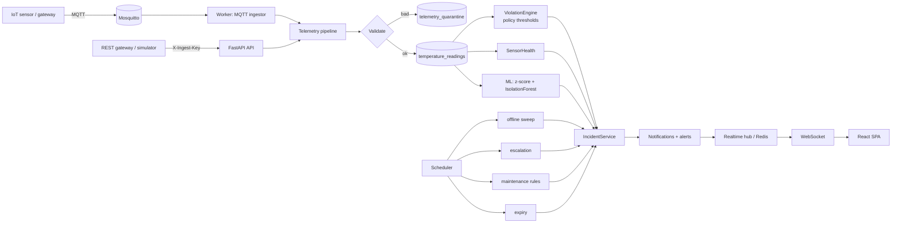

# ColdGuard v2 Architecture

## Backend layers (`backend/app`)
| Layer | Location |
|---|---|
| Routers (thin) | `api/*.py` — every endpoint: `require_permission(...)` + `scope.ensure(facility)` |
| Auth / RBAC | `security/auth.py`, `core/permissions.py`, `services/access.py`, `api/deps.py` |
| Models | `models/*` (32 tables), immutable ledgers guarded in `db/immutability.py` |
| Migrations | `alembic/versions/0002_enterprise_v2_schema.py` (defensive, data-preserving) |
| Domain services | `services/incident.py`, `inventory.py`, `maintenance.py`, `escalation.py`, `telemetry.py` |
| Engines | `engines/quality.py`, `severity.py`, `violation.py` (preserved from v1, policy-aware) |
| ML | `ml/anomaly_service.py`, `ml/features.py`; training/eval in `backend/ml/` |
| Workers | `workers/jobs.py`, `mqtt_ingestor.py`, `runner.py`; standalone `python -m app.worker` |
| Realtime | `services/realtime.py` (in-process + Redis bridge), `api/ws.py` (scope-filtered) |
| Read models | `services/monitoring.py`, `analytics.py`, `reporting.py` |

## Frontend (`frontend/src`)
`app/` (router, shell, role navigation) · `components/` (common, charts, incidents) ·
`features/<role|domain>/` pages · `services/api` (typed client, refresh-on-401) ·
`services/websocket` (reconnecting client, resync after reconnect) · `hooks/useApi`.

## Key design decisions
* Permissions, not role names, everywhere; data scope is a separate concern.
* Enums stored as VARCHAR (no `ALTER TYPE` for new states).
* Datetimes are always UTC-aware (`UTCDateTime`), including on SQLite.
* Incidents deduplicate per unit/sensor (`dedup_key`); repeated signals append events.
* ML anomalies never change stock; clustered anomalies open a WARNING `ABNORMAL_PATTERN` incident.
