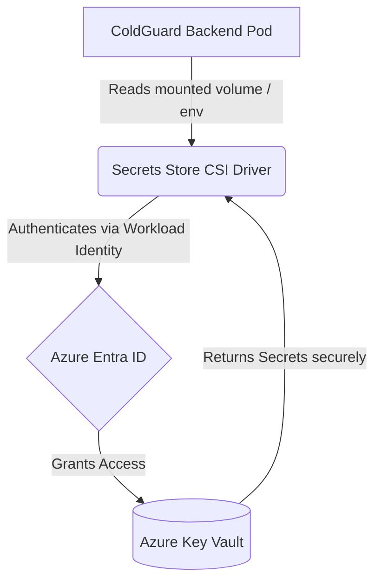

# ColdGuard Azure Key Vault Integration

ColdGuard follows strict security best practices regarding secret management. Production secrets (such as database passwords, API keys, and JWT signatures) must **never** be stored in:
- Source Code
- Docker Images
- Kubernetes YAML Manifests
- GitHub / Version Control
- CI/CD Pipelines (e.g., Jenkinsfile)

To achieve this, ColdGuard uses two distinct secret management workflows depending on the environment:

## 1. Local Development (Sandbox Mode)

For local development and testing, ColdGuard relies on local `.env` files. 

- **Mechanism:** Docker Compose and local processes load environment variables directly from a `.env` file on the developer's machine.
- **Workflow:** 
  1. Developers copy the `.env.example` or `.env.docker` to `.env`.
  2. The `.env` file is heavily excluded in `.gitignore` and `.dockerignore`.
  3. No cloud credentials are required; mock services and local databases (like the Docker PostgreSQL container) are used.

## 2. Azure Production (Key Vault + Managed Identity)

In staging and production, ColdGuard integrates with **Azure Key Vault** to completely remove secrets from the cluster configuration.

### The Production Secret Flow

The architecture leverages **AKS Workload Identity** (or Managed Identity) combined with the **Azure Key Vault Provider for Secrets Store CSI Driver**.

1. **Azure Key Vault**: The central, highly secure repository where all production secrets are stored by administrators.
2. **AKS Workload Identity**: The Kubernetes service account assigned to the ColdGuard backend pod is federated with an Azure Managed Identity. This provides the pod with passwordless authentication to Azure resources.
3. **Secrets Store CSI Driver**: An AKS add-on that requests the secrets from Key Vault (using the workload identity) and mounts them directly into the pod as temporary files or standard Kubernetes Secrets.
4. **ColdGuard Backend**: The application reads the environment variables injected by the Kubernetes Secret (which is kept in sync with Key Vault by the CSI driver). 

### Supported Secrets

The following credentials will be migrated to Azure Key Vault:

- `DATABASE_URL` (Azure Database for PostgreSQL connection string)
- `SECRET_KEY` (JWT signing secret)
- `AZURE_EVENT_HUB_CONNECTION_STRING` (If Event Hubs is enabled)
- `AZURE_STORAGE_CONNECTION_STRING` (If Blob Storage is enabled)
- `AZURE_OPENAI_API_KEY` (Azure OpenAI inference API key)
- `APPLICATIONINSIGHTS_CONNECTION_STRING` (Azure Monitor telemetry key)

### Implementation Roadmap

*Note: Actual Azure SDK authentication code and AKS CSI configuration is intentionally deferred until production cloud credentials and infrastructure are fully provisioned.*

When transitioning to production, the engineering team will:
1. Enable the Key Vault Secrets Provider on the AKS cluster.
2. Create an Azure Managed Identity and grant it `Key Vault Secrets User` access.
3. Create a Kubernetes `ServiceAccount` and annotate it for Workload Identity federation.
4. Define a `SecretProviderClass` in Kubernetes that maps the Azure Key Vault secrets to environment variables.
5. Update `infrastructure/kubernetes/backend-deployment.yaml` to mount the CSI volume and reference the injected secrets.
